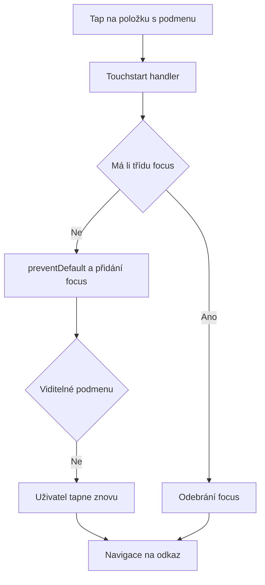

# 01 – Analýza současného stavu

## 1. Kontext šablony

- Klasická PHP šablona (ThemeGrill Accelerate), bez build pipeline pro JS/CSS.
- Menu pohání `wp_nav_menu` s fallbackem `wp_page_menu`
  ([`header.php`](../header.php:110)).
- Veškerá interaktivita menu je v jQuery a vanilla JS v jednom souboru
  [`js/navigation.js`](../js/navigation.js:1), načítaném ve footeru
  ([`inc/functions.php`](../inc/functions.php:67)).
- CSS je monolitický [`style.css`](../style.css:1) s responzivními bloky
  `max-width: 767px`, `768px–1024px` a dalšími
  ([`style.css`](../style.css:2677), [`style.css`](../style.css:2776)).

## 2. Jak menu funguje dnes

### 2.1 PHP markup

```
nav#site-navigation.main-navigation.inner-wrap.clearfix
├── h3.menu-toggle            <- hamburger, není button, není fokusovatelný
└── ul                        <- z wp_nav_menu, bez menu_class
    └── li.menu-item-has-children
        ├── a                 <- odkaz na stránku
        └── ul.sub-menu       <- podmenu
```

Po načtení stránky jQuery injektuje do každého `li.menu-item-has-children`
`<span class="sub-toggle"><i class="fa fa-caret-down"></i></span>`
([`js/navigation.js`](../js/navigation.js:73)).

### 2.2 Hamburger

- Klik na `h3.menu-toggle` pouze přepíše třídu kontejneru mezi
  `main-navigation` a `main-small-navigation`
  ([`js/navigation.js`](../js/navigation.js:32)).
- Třída `toggled`, na kterou odkazuje CSS
  ([`style.css`](../style.css:2811)), se nikdy nenastaví – jde o mrtvý kód.
- Tlačítko není `button`, nemá `aria-expanded`, `aria-controls` ani obsluhu klávesnice.

### 2.3 Otevírání podmenu – dva konfliktní mechanismy

**Mechanismus A – touchstart s preventDefault**
([`js/navigation.js`](../js/navigation.js:86)):

- Navázán na `.menu-item-has-children > a` a `.page_item_has_children > a`.
- První tap: `preventDefault()` + přidání třídy `focus` na `li`.
- Druhý tap: odebrání `focus`, navigace proběhne.
- Expirace podmenu je řešena pouze CSS `.main-navigation ul li.focus > ul.sub-menu`
  ([`style.css`](../style.css:974)).

**Mechanismus B – klik na sub-toggle**
([`js/navigation.js`](../js/navigation.js:75)):

- `slideToggle('1000')` na přímém `ul.sub-menu`, přepnutí třídy `active`.
- Ikona se má otáčet přes `.fa-caret-right`, ale injektovaná ikona je `fa-caret-down`,
  takže selektor nikdy nic nenajde a vizuální stav se nemění
  ([`js/navigation.js`](../js/navigation.js:78)).

**Mechanismus C – focus/blur** ([`js/navigation.js`](../js/navigation.js:44)):
přepíná `focus` na všech `li` předcích; slouží klávesnici, ale na dotyku koliduje s A.

### 2.4 CSS

- Desktop dropdown je čistě hover/focus, skrytý mimo obrazovku přes `left: -99999px`
  ([`style.css`](../style.css:793), [`style.css`](../style.css:823)).
- Tablet 768–1024 px hover dropdown vypíná a zobrazuje `.sub-toggle`
  ([`style.css`](../style.css:2690), [`style.css`](../style.css:2763)).
- Mobil ≤767 px skrývá celé `ul` a spoléhá na class swap hamburgeru
  ([`style.css`](../style.css:2816)).
- `.sub-toggle` je defaultně `display: none` ([`style.css`](../style.css:2442)),
  zobrazuje se pouze v médiích.

## 3. Root cause dvojího kliknutí



Rozhodující je kombinace:

1. `touchstart` handler je aktivní na **všech** dotykových zařízeních bez ohledu na breakpoint.
2. Po rozbalení hamburgeru má kontejner třídu `main-small-navigation`, takže selektor
   `.main-navigation ul li.focus > ul.sub-menu` už neplatí. První tap tedy pouze
   „zamáčkne" odkaz a nic nezobrazí.
3. Druhý tap `focus` odebere a nechá proběhnout navigaci. Uživatel to vnímá jako
   nutnost dvojkliku.
4. Na tabletu se navíc potkávají mechanismy A a B: `focus` zobrazí podmenu přes CSS,
   `slideToggle` nastaví inline `display` – stavy se rozcházejí a další tapy jsou
   nepředvídatelné.
5. `slideToggle('1000')` s frontou animací zvyšuje pocit nereagujícího menu
   při rychlém tapání ([`js/navigation.js`](../js/navigation.js:77)).

## 4. Nálezy

| ID | Nález | Kde | Dopad |
| --- | --- | --- | --- |
| N1 | `preventDefault` na prvním tapu odkazu s podmenu | [`js/navigation.js`](../js/navigation.js:99) | dvojitý tap, ztracená navigace |
| N2 | Dva nezávislé mechanismy otevírání podmenu | [`js/navigation.js`](../js/navigation.js:75), [`js/navigation.js`](../js/navigation.js:86) | rozcházející se stav, dvojité zpracování |
| N3 | `focus` třída se neuklízí spolehlivě | [`js/navigation.js`](../js/navigation.js:44) | zaseknuté otevřené podmenu, návrat zpět |
| N4 | Hamburger přepisuje třídy místo `toggled` | [`js/navigation.js`](../js/navigation.js:32), [`style.css`](../style.css:2811) | mrtvé CSS, ztráta `.main-navigation` selektorů |
| N5 | `sub-toggle` je `span`, malý tap target, bez ARIA | [`js/navigation.js`](../js/navigation.js:73), [`style.css`](../style.css:2800) | špatná dostupnost, obtížné trefení |
| N6 | Ikona se neotáčí, chybí vizuální stav | [`js/navigation.js`](../js/navigation.js:78) | uživatel nevidí, zda je podmenu otevřené |
| N7 | Animace 1000 ms a fronta animací | [`js/navigation.js`](../js/navigation.js:77) | pomalé, zaseknuté přepínání |
| N8 | Více podmenu otevřených současně | [`js/navigation.js`](../js/navigation.js:75) | nepřehledné menu na mobilu |
| N9 | Skryté podmenu zůstává fokusovatelné | [`style.css`](../style.css:793) | Tab vstoupí do neviditelného menu |
| N10 | Hover pravidla bez `@media (hover: hover)` | [`style.css`](../style.css:780), [`style.css`](../style.css:2686) | sticky hover na iOS a tabletech |
| N11 | Tablety >1024 px s dotykem používají desktop hover | [`style.css`](../style.css:810) | dvojitý tap na iPad Pro a hybridních zařízeních |
| N12 | Fallback `wp_page_menu` nemá `sub-toggle` | [`header.php`](../header.php:117) | nekonzistentní chování bez přiřazeného menu |
| N13 | Chybí `menu_class` a JS lepí třídu bez mezery | [`js/navigation.js`](../js/navigation.js:29) | vzniká `menunav-menu`, nespolehlivé selektory |
| N14 | Enqueue bez verze pro cache busting | [`inc/functions.php`](../inc/functions.php:67) | uživatelé dostanou starý JS/CSS |
| N15 | Chybí reset stavu při změně breakpointu/orientace | [`js/navigation.js`](../js/navigation.js:86) | zaseknuté stavy po otočení zařízení |
| N16 | Customizer selective refresh znovu vykreslí menu | [`js/navigation.js`](../js/navigation.js:71) | chybějící toggly nebo duplicitní handlery |
| N17 | `h3.menu-toggle` není fokusovatelný, chybí ARIA | [`header.php`](../header.php:111) | menu nelze otevřít klávesnicí ani čtečkou |
| N18 | `role="navigation"` na elementu `nav` | [`header.php`](../header.php:110) | redundantní ARIA |

## 5. Co naopak funguje a má se zachovat

- Breakpointy a vizuální styl menu (barvy, fonty, spacing) – beze změny.
- Class swap hamburgeru lze zachovat, pokud se na něj naváže správný stav.
- Desktop hover dropdown má zůstat beze změny pro zařízení s hoverem.
- Fallback `wp_page_menu` má zůstat funkční.
- Startovní bod: třídy a ID (`#site-navigation`, `.menu-toggle`, `.sub-toggle`) se nemění,
  aby nezasáhly custom CSS uživatelů.

## 6. Chování po navigaci a kombinace obsahu s podmenu

Aktuální implementace tento scénář neřeší vůbec:

- Po kliknutí na nadřazenou položku se stránka načte a hamburger je zavřený. To je správné
  a záměrné, menu nesmí překrývat obsah.
- WordPress však při vykreslení přidá třídy `current-menu-item`, `current-menu-ancestor`
  a `current-menu-parent` (u stránek `current_page_item`, `current_page_ancestor`,
  `current_page_parent`) na položky odpovídající aktuální URL.
- Tyto třídy aktuální kód nijak nevyužívá, takže uživatel po příchodu na nadřazenou
  stránku musí znovu ručně hledat a rozbalovat její větev.

**N19** – chybí automatické rozbalení aktivní větve při otevření mobilního menu.
**N20** – otevřené podmenu a nadřazený odkaz nejsou vnímatelné jako jeden celek;
nadřazený odkaz sice zůstává v DOM nad podmenu, ale bez rozbalení není vidět souvislost.

Řešení je popsáno ve [02-navrh-reseni.md](02-navrh-reseni.md) jako Varianta D: rozbalení
aktivní větve v JS podle serverových tříd, bez `sessionStorage` a bez změny URL.