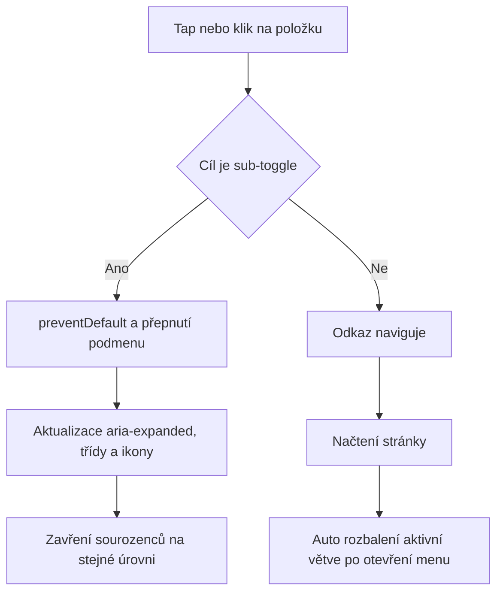

# 02 – Návrh řešení k odsouhlasení

## 1. Cíle a hranice

**Cíle**

- Jediný tap na položku bez podmenu naviguje.
- Jediný tap na text odkazu u položky s podmenu naviguje vždy, bez ohledu na stav podmenu.
- Jediný tap na šipku u položky s podmenu podmenu otevře nebo zavře.
- Když je podmenu otevřené, řádek s nadřazeným odkazem zůstává viditelný a klikatelný.
  Uživatel tedy nemusí na obsah chodit „přes šipku", obojí je na obrazovce současně.
- Po navigaci na stránku, která v menu vystupuje jako nadřazená nebo aktuální, se po otevření
  hamburgeru automaticky rozbalí její větev. Stav se rekonstruuje z WordPress tříd, nikoli
  z úložiště prohlížeče.
- Stav otevření je vizuálně i programově čitelný (`aria-expanded`, ikona).
- Chování je konzistentní na mobilu, tabletu na šířku, hybridních zařízeních a s klávesnicí.
- Desktop hover menu zůstává beze změny.

**Hranice (konzervativní rozsah)**

- Nemění se vizuální styl, barvy, fonty ani rozměry menu.
- Nemění se HTML struktura stránky ani pozice menu v hlavičce.
- Zachovávají se existující třídy a ID, aby nepadlo custom CSS.
- Zachovává se class swap hamburgeru `main-navigation` / `main-small-navigation`.
- Žádná migrace na nový walker v první fázi; případně jako volitelná fáze 2.

## 2. Vyřešení zdánlivého konfliktu obsah versus podmenu

Jeden tap nemůže současně odeslat navigaci a ponechat otevřené inline podmenu, protože
navigace načte novou stránku. Řešení proto skládá tři vrstvy, které uživateli dají obojí:

| Vrstva | Co řeší | Jak |
| --- | --- | --- |
| 1. Viditelný nadřazený řádek | obsah i podmenu na obrazovce současně | nadřazený `a` zůstává nad rozbaleným `ul.sub-menu`, je stále klikatelný |
| 2. Navigace jedním tapem | žádný dvojklik | text odkazu nikdy nevolá `preventDefault` |
| 3. Automatické rozbalení aktivní větve | po refreshi není nutné hledat šipku | JS rozbalí `li` s `current-menu-item`, `current-menu-ancestor`, `current-menu-parent` a obdobnými třídami |

**Proč ne `sessionStorage`:** držení otevřeného hamburgeru přes navigaci by menu nechalo
překrývat obsah a vytvářelo zastaralé stavy po návratu zpět. WordPress třídy jsou
serverová pravda, fungují i při přímém odkazu, při刷新 a při návratu tlačítkem zpět.

**Volitelná nadstavba, pokud bude potřeba:** první položkou podmenu může být odkaz
„Přehled" na stejnou URL, jakou má nadřazená položka. Řeší se walkerem až ve fázi F3,
není nutné pro odstranění dvojkliku.

## 3. Cílové chování



| Situace | Dnes | Po opravě |
| --- | --- | --- |
| Tap na běžnou položku | navigace | navigace |
| Tap na text položky s podmenu, mobil | nic, druhý tap naviguje | navigace na první tap |
| Tap na šipku položky s podmenu | někdy otevře, někdy ne | otevře nebo zavře na první tap |
| Otevřené podmenu a potřeba na obsah | nutné hledat jinou cestu | nadřazený řádek je stále viditelný a klikatelný |
| Příchod na nadřazenou stránku | větev sbalená | po otevření hamburgeru je větev rozbalená |
| Tap na text položky s podmenu, tablet | konflikt focus a slideToggle | navigace na první tap |
| Otevřená dvě podmenu současně | možné | ne, sourozenci se zavírají |
| Klávesnice | hamburger nefokusovatelný | plná obsluha Enter, Space, Escape |
| Otočení zařízení | zaseknutý stav | reset stavu |

## 4. Porovnání variant

### Varianta A – oddělené ovládání

Odkaz naviguje, šipka (samostatný `button.sub-toggle`) otevírá podmenu.

- Plus: žádný dvojitý tap, předvídatelné chování, dobrá dostupnost.
- Mínus: bez další vrstvy by uživatel musel šipku objevit a po navigaci ji znovu hledat.

### Varianta B – akordeon na odkazu

První tap otevře podmenu, druhý tap naviguje.

- Plus: menší změna logiky.
- Mínus: **záměrně zachovává dvojitý tap**, tedy přesně to, co má být odstraněno.
- Nedoporučeno.

### Varianta C – server-side Walker s buttonem

PHP walker vygeneruje `button.sub-toggle` přímo v HTML.

- Plus: funguje i bez zpoždění JS, žádné duplicity při Customizer refreshi.
- Mínus: nový soubor, úprava voleb `wp_nav_menu`, vyšší riziko regrese.
- Vhodné jako fáze F3.

### Varianta D – A + automatické rozbalení aktivní větve, doporučená

Varianta A doplněná o rekonstrukci stavu z WordPress tříd.

- Plus: odstraňuje dvojklik a současně řeší „obsah i podmenu" bez reloadu a bez šipek jako
  jediné cesty.
- Plus: funguje po refreshi, při přímém odkazu i po tlačítku zpět, bez úložiště.
- Plus: žádný zásah do uloženého menu ani do URL.
- Mínus: po prvním příchodu na zcela novou stránku je větev rozbalená až po otevření
  hamburgeru, což je ale očekávané a konzistentní.

**Doporučení: Varianta D.** Teprve pokud by auto-expand vadil, použít A jako minimální variantu.

## 5. Kompatibilita

### 5.1 PHP 7.4.33

- Navržené změny používají pouze `filemtime()`, `wp_localize_script()`, pole a překladové
  funkce. Žádná syntaxe PHP 8.
- Nepoužívat `str_contains`, `str_starts_with`, arrow funkce, union typy, named arguments,
  nullsafe operátor ani `match`.
- `filemtime()` volat s fallbackem, aby na některých hostinzích nevznikl warning:

```php
$version = @filemtime( get_template_directory() . '/js/navigation.js' );
if ( ! $version ) {
	$version = wp_get_theme()->get( 'Version' );
}
wp_enqueue_script( 'accelerate-navigation', ACCELERATE_JS_URL . '/navigation.js', array( 'jquery' ), $version, true );
```

### 5.2 WordPress 6.x až 7.x včetně 7.1.4

- `wp_nav_menu`, `wp_page_menu`, `wp_enqueue_script`, `wp_localize_script` a třídy
  `menu-item-has-children`, `current-menu-ancestor`, `current-menu-parent` jsou stabilní
  a nedeprecované.
- `wp_page_menu()` je legacy, ale stále funkční; zachováváme ho kvůli zpětné kompatibilitě.
- Šablona je klasická, nepoužívá block theme ani `theme.json`; změny jsou na tom nezávislé.
- JS používá jen základní jQuery API (`on`, `closest`, `children`, `slideToggle`), dostupné
  v jQuery bundlovaném WordPressem.
- JS psát v ES5 (`var`, `function`), bez `Element.closest`, bez šablonových literálů, aby
  zůstala kompatibilita s staršími WebView.

## 6. Konkrétní změny po souborech

### 6.1 `js/navigation.js` – hlavní oprava

**Odstranit**

- Celý blok `touchstart` s `preventDefault()`
  ([`js/navigation.js`](../js/navigation.js:86)) – příčina dvojitého tapu.
- Závislost na `.fa-caret-right`, která nikdy neexistuje
  ([`js/navigation.js`](../js/navigation.js:78)).

**Zavést**

1. Jediný delegovaný `click` handler na `#site-navigation` pro `.sub-toggle`.
2. `preventDefault()` a `stopPropagation()` pouze na tlačítku šipky, nikdy na odkazu.
3. Přepínání `aria-expanded`, třídy `active` a `sub-menu-open` na `li`.
4. Akordeon: při otevření zavřít sourozence na stejné úrovni.
5. Animaci zkrátit na ~200 ms a používat `stop(true, true)` proti frontě animací.
6. Automatické rozbalení aktivní větve podle WordPress tříd, bez animace.
7. Reset stavů při změně breakpointu nebo orientace.
8. Zavření na `Escape` a klik mimo menu.
9. Ochranu proti dvojí inicializaci (Customizer selective refresh) přes data atribut.

**Návrh kostry**

```js
jQuery( function ( $ ) {
	var $nav = $( '#site-navigation' );
	if ( ! $nav.length || $nav.data( 'accelerate-menu-init' ) ) {
		return;
	}
	$nav.data( 'accelerate-menu-init', true );

	function setState( $btn, open, animate ) {
		var $li  = $btn.parent();
		var $sub = $li.children( 'ul.sub-menu, ul.children' ).first();

		$btn.attr( 'aria-expanded', open ? 'true' : 'false' )
			.toggleClass( 'active', open )
			.find( '.screen-reader-text' )
			.text( open ? accelerateMenuL10n.collapse : accelerateMenuL10n.expand );

		$li.toggleClass( 'sub-menu-open', open );

		if ( animate ) {
			$sub.stop( true, true )[ open ? 'slideDown' : 'slideUp' ]( 200 );
		} else {
			$sub.stop( true, true )[ open ? 'show' : 'hide' ]();
		}
	}

	function autoExpandCurrentBranch() {
		$nav.find(
			'li.current-menu-item, li.current_page_item,' +
			' li.current-menu-ancestor, li.current-menu-parent,' +
			' li.current_page_ancestor, li.current_page_parent'
		).each( function () {
			var $li  = $( this );
			var $btn = $li.children( '.sub-toggle' );

			if ( $btn.length && $li.children( 'ul.sub-menu, ul.children' ).length ) {
				setState( $btn, true, false );
			}
		} );
	}

	$nav.on( 'click', '.sub-toggle', function ( e ) {
		e.preventDefault();
		e.stopPropagation();

		var $btn = $( this );
		var open = $btn.attr( 'aria-expanded' ) !== 'true';

		$btn.parent().siblings( '.sub-menu-open' )
			.children( '.sub-toggle' ).each( function () {
				setState( $( this ), false, true );
			} );

		setState( $btn, open, true );
	} );

	$( document ).on( 'keydown', function ( e ) {
		if ( 'Escape' === e.key ) {
			$nav.find( '.sub-menu-open > .sub-toggle' ).each( function () {
				setState( $( this ), false, true );
			} );
		}
	} );

	autoExpandCurrentBranch();

	var mq = window.matchMedia( '(max-width: 1024px), (hover: none)' );
	function reset() {
		$nav.find( '.sub-toggle' ).attr( 'aria-expanded', 'false' ).removeClass( 'active' );
		$nav.find( '.sub-menu-open' ).removeClass( 'sub-menu-open' )
			.children( 'ul.sub-menu, ul.children' ).removeAttr( 'style' );
		$nav.find( '.sub-menu' ).removeAttr( 'style' );

		if ( mq.matches ) {
			autoExpandCurrentBranch();
		}
	}
	mq.addEventListener ? mq.addEventListener( 'change', reset ) : mq.addListener( reset );
} );
```

**Injektáž tlačítek** – nahradit `span` za `button`, doplnit ARIA a unikátní `id` podmenu:

```js
$nav.find( '.menu-item-has-children, .page_item_has_children' ).each( function ( i ) {
	var $li  = $( this );
	var $sub = $li.children( 'ul.sub-menu, ul.children' ).first();

	if ( ! $sub.length || $li.children( '.sub-toggle' ).length ) {
		return;
	}
	if ( ! $sub.attr( 'id' ) ) {
		$sub.attr( 'id', 'accelerate-sub-menu-' + i );
	}

	$li.children( 'a' ).first().after(
		'<button type="button" class="sub-toggle" aria-expanded="false"' +
		' aria-controls="' + $sub.attr( 'id' ) + '">' +
		'<i class="fa fa-caret-down" aria-hidden="true"></i>' +
		'<span class="screen-reader-text">' + accelerateMenuL10n.expand + '</span>' +
		'</button>'
	);
} );
```

`autoExpandCurrentBranch()` se volá po injektáži a znovu po otevření hamburgeru, protože
WP třídy jsou v DOM už při načtení stránky.

**Hamburger** – zpřesnit class swap a doplnit ARIA:

```js
var $toggle = $nav.children( '.menu-toggle' );

$toggle.attr( 'aria-expanded', 'false' )
	.on( 'click', function () {
		var expanded = $( this ).attr( 'aria-expanded' ) === 'true';
		$( this ).attr( 'aria-expanded', expanded ? 'false' : 'true' );
		$nav.toggleClass( 'main-small-navigation', ! expanded )
			.toggleClass( 'main-navigation', expanded );

		if ( ! expanded ) {
			autoExpandCurrentBranch();
		}
	} );
```

Poznámka: class swap zůstává kvůli zpětné kompatibilitě s custom CSS. Mrtvá třída `toggled`
se přestane používat.

### 6.2 `header.php` – přístupný hamburger a menu_class

- Nahradit `<h3 class="menu-toggle">` za `<button type="button" class="menu-toggle"
  aria-expanded="false" aria-controls="primary-menu">`; vizuál zůstane díky
  `.site-header .menu-toggle` a pseudo-prvku `:before`
  ([`header.php`](../header.php:111)).
- Odstranit redundantní `role="navigation"` z `<nav>`
  ([`header.php`](../header.php:110)).
- Doplnit `menu_class => 'nav-menu'`, `menu_id => 'primary-menu'`, `container => false`
  u `wp_nav_menu` a `menu_class => 'nav-menu'` u `wp_page_menu`
  ([`header.php`](../header.php:113)).
- Tím se opraví i lepení tříd bez mezery v JS
  ([`js/navigation.js`](../js/navigation.js:29)).

### 6.3 `style.css` – jednotné a bezpečné chování

**Upravit**

- `.sub-toggle` default `display: none` zůstává
  ([`style.css`](../style.css:2442)).
- Zobrazit `.sub-toggle` nejen v `768–1024 px`, ale v celém dotykovém režimu:

```css
@media (max-width: 1024px), (hover: none) {
	.sub-toggle {
		display: flex;
		align-items: center;
		justify-content: center;
		position: absolute;
		top: 0;
		right: 0;
		bottom: 0;
		width: 48px;
		min-width: 44px;
		min-height: 44px;
		padding: 0;
		background: transparent;
		border: 0;
		cursor: pointer;
		color: #222;
		touch-action: manipulation;
		-webkit-tap-highlight-color: transparent;
	}
	.menu-item-has-children > a,
	.page_item_has_children > a {
		padding-right: 56px;
	}
	.sub-toggle .fa {
		transition: transform 0.2s ease;
	}
	.sub-toggle.active .fa {
		transform: rotate(180deg);
	}
}
```

- Sjednotit skrývání podmenu pro oba stavy kontejneru:

```css
@media (max-width: 767px) {
	.main-navigation ul ul,
	.main-small-navigation ul ul {
		position: static;
		float: none;
		left: auto;
		top: auto;
		width: auto;
		margin-left: 0;
		border: 0;
	}
	.main-navigation .sub-menu,
	.main-small-navigation .sub-menu {
		display: none;
	}
	.main-navigation li.sub-menu-open > .sub-menu,
	.main-small-navigation li.sub-menu-open > .sub-menu {
		display: block;
	}
}
```

- **Nepřidávat** CSS pravidlo `display: block` pro `li.current-menu-ancestor > ul`, jinak by
  nešlo podmenu ručně zavřít. Rozbalení aktivní větve řídí pouze JS přes `sub-menu-open`.
- Vypnout hover dropdown na dotyku i nad 1024 px (iPad Pro, hybridní notebooky):

```css
@media (hover: none) {
	.main-navigation ul li:hover > ul,
	.main-navigation ul ul li:hover > ul {
		left: -99999px;
	}
}
```

- Hover pravidla obalit `@media (hover: hover)`, aby na iOS nezůstával sticky hover
  ([`style.css`](../style.css:780), [`style.css`](../style.css:2686)).
- Doplnit normalizaci pro `button.menu-toggle` (`width: 100%`, `border: 0`,
  `font: inherit`), aby se vzhled nelišil od původního `h3`.
- Doplnit `:focus-visible` obrys pro `.sub-toggle` a `.menu-toggle`.

**Volitelně fáze 2 – skrytá podmenu nesmí být fokusovatelná**

- Nahradit `left: -99999px` za kombinaci `opacity`/`visibility` se stejnou animací
  ([`style.css`](../style.css:793)), nebo doplnit `visibility: hidden` a zobrazovat
  při `:hover`, `.focus` a `:focus-within`.

### 6.4 `rtl.css` – parita

- Zrcadlit nové odsazení a pozici `.sub-toggle` (`left` místo `right`)
  ([`rtl.css`](../rtl.css:430)).
- Ověřit, že nové override bloky v `style.css` platí i pro RTL.

### 6.5 `inc/functions.php` – lokalizace a cache busting

- Přidat `wp_localize_script` s popisky pro čtečky:

```php
wp_localize_script( 'accelerate-navigation', 'accelerateMenuL10n', array(
	'expand'   => __( 'Open submenu', 'accelerate' ),
	'collapse' => __( 'Close submenu', 'accelerate' ),
) );
```

- Nahradit `false` u verze skriptu za `filemtime()` s fallbackem na verzi šablony, aby se
  změny dostaly k uživatelům bez mazání cache
  ([`inc/functions.php`](../inc/functions.php:67)).
- Stejný princip u `accelerate-custom` a `style.css`, pokud se bude měnit i CSS.

## 7. Fázování

| Fáze | Obsah | Podmínka |
| --- | --- | --- |
| F1 | JS handler, odstranění touchstart, ARIA, auto-expand aktivní větve, CSS dotykový režim, hamburger button, lokalizace, cache busting | kritická oprava dvojího tapu a požadavku obsah plus podmenu |
| F2 | Sticky hover, fokusovatelná skrytá podmenu, RTL parita, reset při orientaci | doporučeno dokončit v rámci stejného úkolu |
| F3 | Server-side walker a volitelný odkaz Přehled v podmenu | volitelné, pouze pokud F1 nestačí |

Doporučení: provést F1 a F2 v jednom uceleném commitu nebo ve dvou menších commitech
(JS + PHP, poté CSS + RTL), aby byl snadný revert.

## 8. Rizika a mitigace

| Riziko | Pravděpodobnost | Mitigace |
| --- | --- | --- |
| Custom CSS child theme cílí na `h3.menu-toggle` | střední | zachovat třídu, přidat `button.menu-toggle` normalizaci, uvést v changelogu |
| Custom CSS cílí na `span.sub-toggle` | nízká | zachovat třídu `sub-toggle`, mění se jen element |
| `hover: none` nepodporováno ve starém prohlížeči | nízká | fallback `max-width: 1024px` pokrývá telefony a tablety |
| Dvojí inicializace v Customizeru | střední | data atribut a delegované handlery |
| Inline `display` z `slideToggle` zůstane po resetu | střední | `removeAttr('style')` v reset funkci a při změně breakpointu |
| Auto-expand rozbalí i větev, kterou uživatel zavřel | nízká | auto-expand pouze při inicializaci a při otevření hamburgeru, ne při každém překreslení |
| Změna voleb `wp_nav_menu` ovlivní pluginy | nízká | `container => false` pouze pro primární menu, ID `primary-menu` zkontrolovat proti konfliktům |
| Starší WebView bez `matchMedia.addEventListener` | nízká | fallback `addListener` |

**Rollback:** změny jsou izolované v pěti souborech; revert commitu obnoví původní chování.
Zachování tříd a ID zajišťuje, že se při rollbacku nerozbije vzhled.

## 9. Akceptační kritéria

1. Tap na text položky s podmenu na mobilu provede navigaci napoprvé.
2. Tap na šipku otevře podmenu napoprvé a neprovede navigaci.
3. Druhý tap na šipku podmenu zavře.
4. Při otevřeném podmenu je nadřazený odkaz stále viditelný a tap na něj naviguje.
5. Po příchodu na nadřazenou stránku a otevření hamburgeru je její větev rozbalená.
6. Otevřením jednoho podmenu se zavřou sourozenci na stejné úrovni.
7. `aria-expanded` odpovídá skutečnému stavu u všech tlačítek.
8. `Escape` zavře otevřené podmenu a vrátí fokus na tlačítko.
9. Hamburger je ovladatelný klávesnicí a má `aria-expanded`.
10. Otočení zařízení nebo přechod breakpointu nenechá zaseknuté otevřené podmenu.
11. Na desktopu s hoverem se chování dropdownu nezmění.
12. Na iPadu a tabletu 768–1024 px funguje otevírání i zavírání na první tap.
13. Třetí úroveň menu funguje stejně jako druhá.
14. Bez JS zůstává menu čitelné a odkazy dostupné v rozumné míře.
15. PHP 7.4.33 a WordPress 6.x/7.x: žádné warningy, žádné deprecated hlášky.

## 10. Body k odsouhlasení

1. **Varianta D** (A + auto-expand aktivní větve) versus pouze Varianta A.
2. Rozsah **F1 + F2** versus pouze F1.
3. Zda změnit `h3.menu-toggle` na `button` (doporučeno) – může zasáhnout custom CSS.
4. Zda odložit server-side walker a odkaz Přehled (F3) na později (doporučeno).
5. Zda zachovat class swap hamburgeru (doporučeno) místo přechodu na třídu `toggled`.